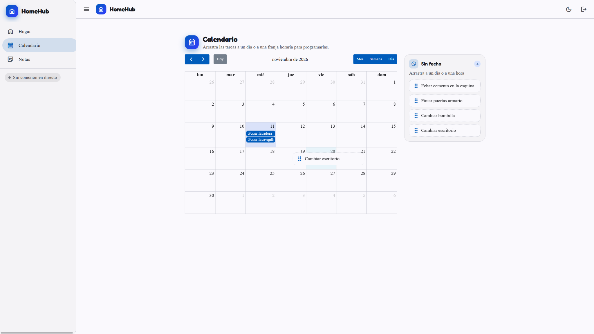
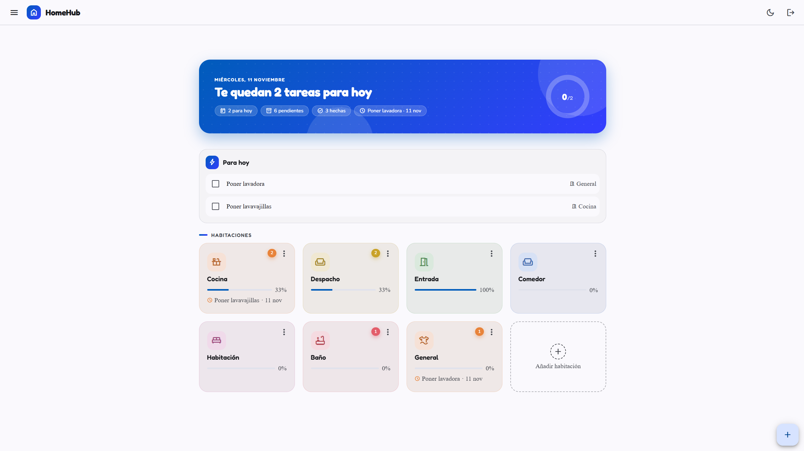
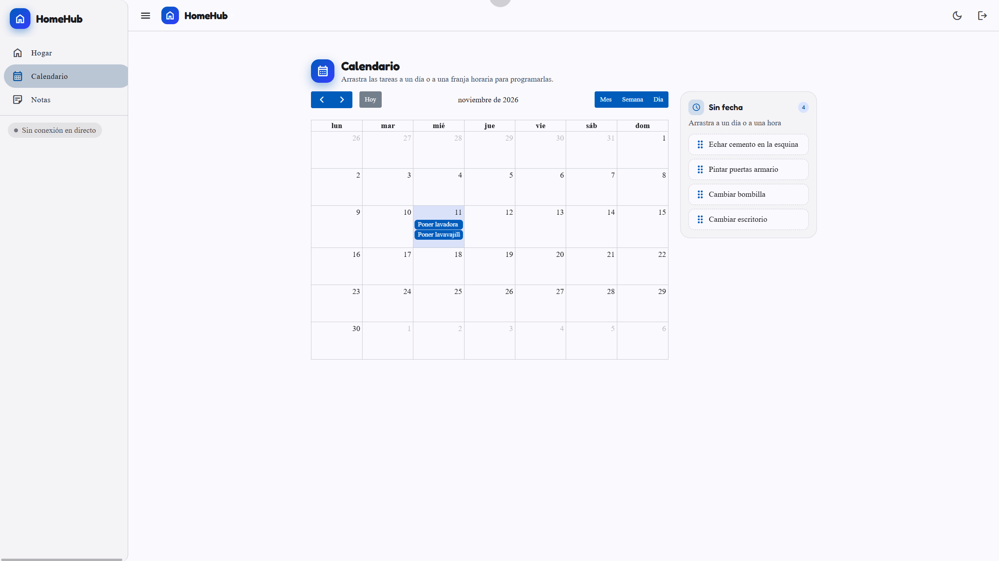
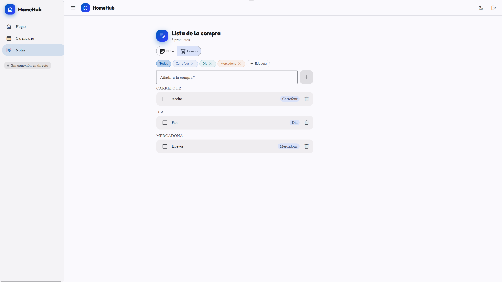
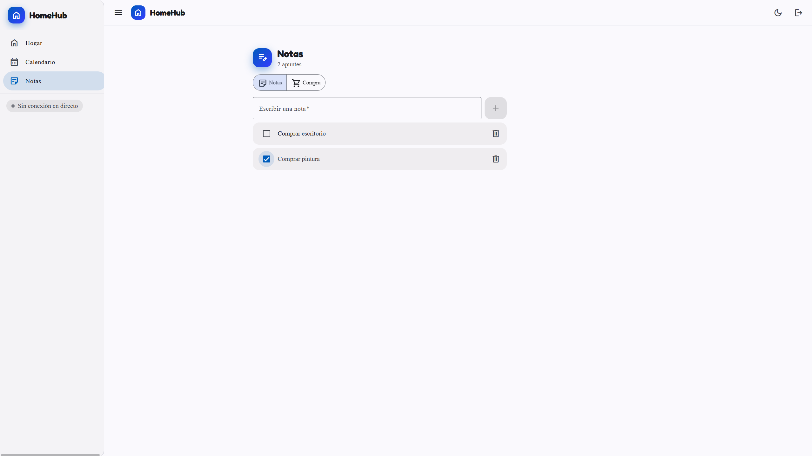
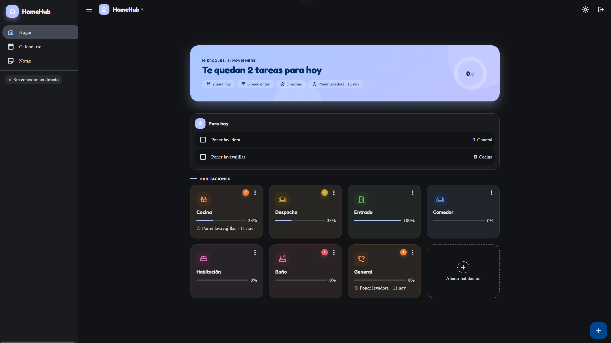
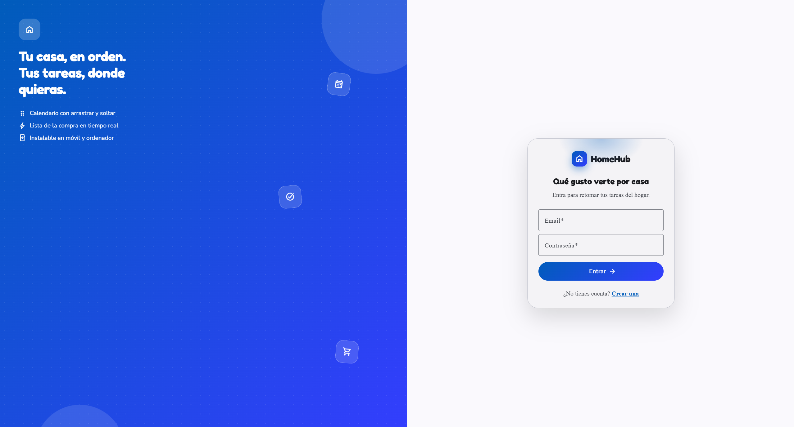
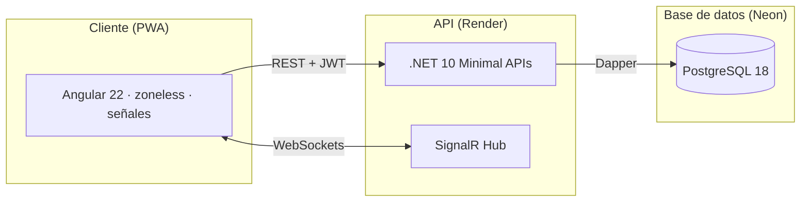

# HomeHub

Aplicación full-stack para organizar las tareas del hogar: habitaciones, tareas recurrentes, calendario con arrastrar y soltar, notas y lista de la compra compartida con actualización en tiempo real. Instalable como app (PWA) y con modo oscuro.

[](https://github.com/idarkar3000/HomeHub/actions/workflows/ci.yml)


## Demo

La aplicación está desplegada y lista para probar: **[home-hub-pearl.vercel.app](https://home-hub-pearl.vercel.app)**

Regístrate desde la propia app (el registro está abierto) o usa dos dispositivos con la misma cuenta para ver la sincronización en tiempo real de la lista de la compra.

<p align="center">
  
</p>

## Capturas

Vistas reales de la aplicación desplegada. Las imágenes están en [`docs/screenshots/`](docs/screenshots/).

| Hogar | Calendario |
|---|---|
|  |  |

| Lista de la compra | Notas |
|---|---|
|  |  |

| Modo oscuro | Iniciar sesión |
|---|---|
|  |  |

## Funcionalidades

- **Habitaciones**: organiza las tareas por estancias, con progreso y próxima tarea de cada una.
- **Tareas**: fecha de vencimiento con día completo o franja horaria, recurrencia (diaria, semanal, mensual) que avanza al completar.
- **Calendario** (FullCalendar): mes/semana/día, arrastrar y soltar para agendar (también táctil) y bandeja lateral de tareas sin fecha.
- **Notas y lista de la compra**: notas rápidas y compra con **etiquetas** (Mercadona, Día...) para filtrar y agrupar.
- **Tiempo real** (SignalR): cualquier cambio en notas o etiquetas se refleja al instante en el resto de dispositivos de la cuenta.
- **PWA**: instalable en Android/iOS/escritorio, funciona como app nativa.
- **Modo oscuro**: botón de tema en la barra superior, recuerda la preferencia y por defecto sigue al sistema.
- **Salud y monitorización**: endpoint `/health` que comprueba PostgreSQL y es sondeado por UptimeRobot para evitar el arranque frío del plan free de Render.

## Arquitectura



| Capa | Tecnología |
|---|---|
| Frontend | Angular 22 (standalone, zoneless, señales), Angular Material 3, FullCalendar, PWA |
| Backend | .NET 10 Minimal APIs, Dapper, SignalR, JWT |
| Base de datos | PostgreSQL 18 (Neon) |
| Despliegue | Vercel (frontend), Render (API, Docker), Neon (BD) |
| Tests | xUnit + WebApplicationFactory (integración de API con repositorios fake) |

## Decisiones técnicas

- **Minimal APIs + Dapper** en lugar de controllers + EF Core: menos abstracción y SQL explícito, que es lo que se necesita en una API CRUD pequeña.
- **Angular zoneless con señales**: sin zonas, el estado de la UI se actualiza solo donde cambia.
- **Tests de integración de la API real** (`WebApplicationFactory`) sustituyendo los repositorios por fakes en memoria: se prueba el pipeline completo (routing, auth, validación) sin tocar la base de datos.
- **SignalR con grupos por usuario**: cada conexión se une al grupo de su cuenta, así los cambios solo viajan a los dispositivos que interesan.
- **Aislamiento por usuario en todas las consultas**: lecturas, actualizaciones y borrados filtran por `user_id`, no solo por `id`. Los tests de ownership comprueban que una cuenta no puede tocar datos de otra.
- **Rate limiting por IP en autenticación**, cabeceras de seguridad y health check que comprueba PostgreSQL de verdad.
- **Migraciones idempotentes en el arranque** (`CREATE TABLE IF NOT EXISTS` / `ADD COLUMN IF NOT EXISTS`): sin herramienta externa de migraciones para un proyecto de este tamaño.

## Estructura del repositorio

```
HomeHub/                     API .NET
  Endpoints/                 Rutas agrupadas por dominio (rooms, tasks, notes...)
  Hubs/                      SignalR (NotesHub)
  Models/ y Models/Dtos/     Entidades y objetos de petición
  Repositories/              Persistencia con Dapper + PostgreSQL
tests/HomeHub.Tests/         Tests de integración (xUnit)
ui/                          Aplicación Angular
  src/app/core/              modelos, servicios, guards e interceptores
  src/app/features/          páginas (rooms, calendar, notes, auth)
  src/app/shared/            componentes reutilizables
docs/screenshots/            Capturas usadas en este README
```

## API

Toda la API requiere JWT salvo autenticación y salud. Documentación OpenAPI en desarrollo en `/swagger`.

- `POST /api/auth/register` · `POST /api/auth/login`
- `GET|POST|PUT|DELETE /api/rooms`
- `GET|POST|PUT|PATCH|DELETE /api/tasks` (incluye `PATCH /toggle` con avance de recurrencia y `GET /calendar`)
- `GET|POST|PUT|PATCH|DELETE /api/notes` (notas y lista de la compra con `kind` y `categoryId`)
- `GET|POST|DELETE /api/shopping-categories`
- `GET /health` · `GET /`
- WebSocket: `/hubs/notes`

## Desarrollo local

Requisitos: .NET 10 SDK, Node 24, PostgreSQL.

1. Configura los secretos en local. Puedes copiar `HomeHub/appsettings.Example.json` a
   `HomeHub/appsettings.Development.json` (ignorado por git) o usar user-secrets:

```bash
dotnet user-secrets init --project HomeHub
dotnet user-secrets set "ConnectionStrings:DefaultConnection" "Host=localhost;Port=5432;Database=homehub;Username=homehub;Password=homehub" --project HomeHub
dotnet user-secrets set "Jwt:Key" "una-clave-larga-y-aleatoria-para-desarrollo-local" --project HomeHub
dotnet user-secrets set "Jwt:Issuer" "HomeHub" --project HomeHub
dotnet user-secrets set "Jwt:Audience" "HomeHub" --project HomeHub
```

> No subas nunca `appsettings.json` ni `appsettings.Development.json` con credenciales reales.
> El repositorio ya los ignora; usa `appsettings.Example.json` como plantilla sin secretos.

2. Arranca el backend:

```bash
dotnet run --project HomeHub
```

3. Arranca el frontend en otra terminal:

```bash
cd ui
npm ci
npm start
```

Abre `http://localhost:4200`. Las tablas se crean solas al arrancar la API.

## Tests

```bash
# Backend: API completa en memoria con repositorios fake
dotnet test tests/HomeHub.Tests/HomeHub.Tests.csproj

# Frontend: servicios, guard e interceptor con Vitest
cd ui
npm test -- --watch=false
```

Los tests de backend cubren autenticación, validaciones, todos los endpoints y el aislamiento de datos entre usuarios. Los de frontend cubren la sesión, el guard de rutas y el interceptor de autenticación. El CI ejecuta ambas suites, compila la API y genera el build de producción de Angular.

## Despliegue

- **Frontend** en Vercel desde `ui/` (build de Angular + PWA service worker).
- **API** en Render desde el `Dockerfile`, con variables de entorno para cadena de conexión, JWT y CORS.
- **Base de datos** en Neon (PostgreSQL serverless).
- `GET /health` monitorizado con UptimeRobot cada 5 minutos para mantener la API despierta en el plan gratuito.
